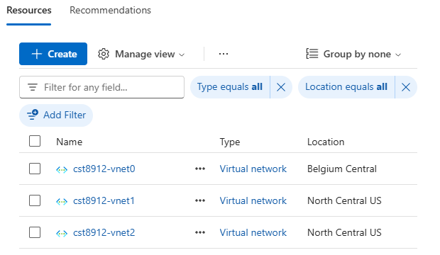
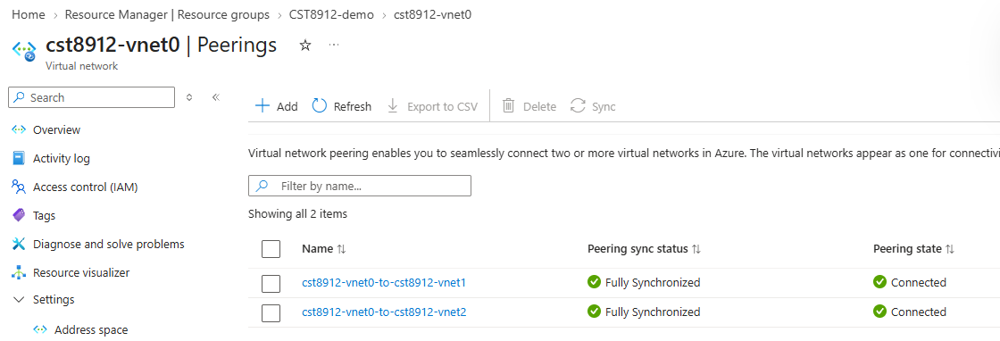
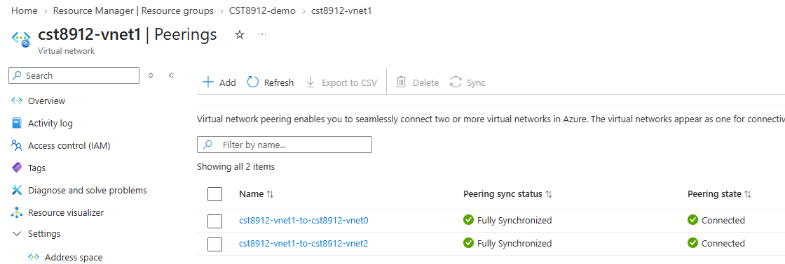
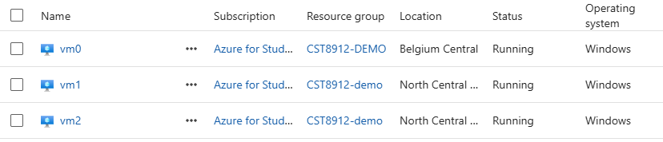
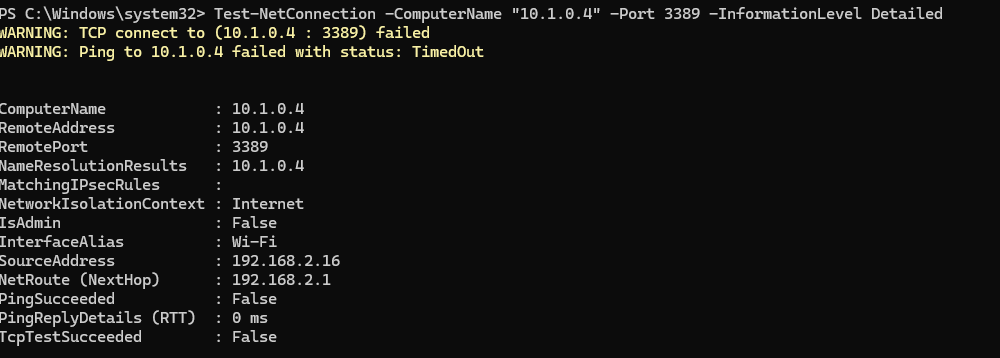

# CST8912 Cloud Solution Architecture
# Graded Lab Activity 2 — Azure VNet Peering

Date: October 9, 2026

## Purpose

This lab explored how Azure virtual networks, peering, network security groups, and virtual machines work together in an Infrastructure as a Service solution. I deployed three Windows VMs across two regions and configured local and global VNet peering. Infrastructure deployment was completed; private connectivity testing and final cleanup were incomplete at the time of submission.

## Regions and resource configuration

Region A was Belgium Central and Region B was North Central US. Both regions appeared in the subscription’s allowed deployment locations. The resource group was CST8912-demo. Its metadata location remained Canada Central, while the resources used the regions listed below.

| Virtual network | Region | VNet address space | Default subnet | VM | Private IP |
|---|---|---|---|---|---|
| cst8912-vnet0 | Belgium Central | 10.0.0.0/16 | 10.0.0.0/24 | vm0 | 10.0.0.4 |
| cst8912-vnet1 | North Central US | 10.1.0.0/16 | 10.1.0.0/24 | vm1 | 10.1.0.4 |
| cst8912-vnet2 | North Central US | 10.2.0.0/16 | 10.2.0.0/24 | vm2 | 10.2.0.4 |

All three VMs were observed in Running state. The selected operating system was Windows Server 2022 Datacenter x64 Gen2. Standard SSD was specified for the OS disks. Standard_B2als_v2 was used as the alternative VM size, providing 2 vCPUs and 4 GiB of memory.

## Local and global peering

Local peering connects virtual networks in the same Azure region. Global peering connects virtual networks in different Azure regions. Peering allows private traffic to pass between the networks over Microsoft’s backbone network.

| Network pair | Type | Configuration |
|---|---|---|
| vnet0 and vnet1 | Global peering | Belgium Central to North Central US |
| vnet0 and vnet2 | Global peering | Belgium Central to North Central US |
| vnet1 and vnet2 | Local peering | Both in North Central US |

Each pair was configured with access allowed in both directions. Forwarded traffic and gateway options were left disabled. Direct peering was configured between every pair because VNet peering is not transitive: peering vnet1 and vnet2 separately with vnet0 does not automatically connect vnet1 to vnet2 through vnet0.

The three networks use non-overlapping address spaces. This prevents conflicting destination addresses and allows traffic to be routed to the intended network.

The final vnet0 screenshot showed its links to vnet1 and vnet2 as Connected and Fully Synchronized. The final vnet1 screenshot showed its links to vnet0 and vnet2 in the same states. The corresponding remote links were created through the two-way peering form, but a final screenshot of the recreated vnet2 peering list was not captured.

## VM access controls

vm0 was configured with a public IP address to provide the lab’s RDP entry point. Its inbound rule allowed TCP port 3389. I changed the rule’s source from Any to my current public IPv4 address with a /32 prefix and saved the change.

vm1 and vm2 were configured without public IP addresses and with no public inbound ports. Basic network security groups were selected. The default AllowVNetInBound rule permits traffic from directly peered virtual networks, allowing private RDP connectivity without public RDP rules on these VMs.

Temporary VM administrator credentials were used. Passwords and public IP addresses are omitted from this report.

## Connectivity testing and interpretation

An initial Test-NetConnection command was accidentally run on my local computer rather than inside vm0. The output identified a Wi-Fi interface and source address 192.168.2.16. The TCP test to 10.1.0.4 on port 3389 returned TcpTestSucceeded: False, and the ping timed out.

This result does not establish a failure of Azure peering because the source was outside the Azure lab networks. The correct test source should have been vm0 at 10.0.0.4. I then began connecting to vm0 through the downloaded RDP file. A certificate identifying vm0 and the Remote Desktop connection warning were displayed, but successful desktop sign-in and the required private tests were not documented before submission.

| Required source | Destination | TCP port | Result at submission |
|---|---|---|---|
| vm0 | vm1 — 10.1.0.4 | 3389 | Not completed from the required source |
| vm0 | vm2 — 10.2.0.4 | 3389 | Not completed from the required source |
| vm1 | vm2 — 10.2.0.4 | 3389 | Not completed |

The intended commands inside vm0 were:

```powershell
hostname
Test-NetConnection -ComputerName "10.1.0.4" -Port 3389 -InformationLevel Detailed
Test-NetConnection -ComputerName "10.2.0.4" -Port 3389 -InformationLevel Detailed
```

The intended command inside vm1, after connecting to it from vm0 using its private IP, was:

```powershell
hostname
Test-NetConnection -ComputerName "10.2.0.4" -Port 3389 -InformationLevel Detailed
```

TcpTestSucceeded: True would confirm that TCP port 3389 on the destination VM is reachable from the source VM. It would not measure application performance or prove that every port is accessible. If a correctly sourced test fails, the checks include VM running state, destination private IP, peering status, and effective network security rules.

## Troubleshooting and configuration changes

Canada Central was originally selected for Region A, but the intended VM sizes were unavailable for the subscription there. Region A was changed to Belgium Central. vnet0 was recreated with its original address space, and vnet1 and vnet2 were recreated in North Central US. All three peering pairs were then configured again.

Standard_B2s was unavailable during size selection, so Standard_B2als_v2 was selected. This meets the lab’s minimum hardware requirement of 2 vCPUs and 4 GiB memory. Instructor approval for this substitution has not been documented.

During peering setup, selecting vnet0 as its own remote network caused a validation error. Selecting a different remote VNet resolved the issue. When only vnet0 appeared in the remote-network list, the resource group was inspected and the missing vnet1 and vnet2 networks were recreated.

The VM creation form initially proposed an unrelated network using 172.16.0.0/24. Switching the region to North Central US and back to Belgium Central refreshed the network list. vm0 was then correctly assigned to cst8912-vnet0 and the default subnet at 10.0.0.0/24.

## Evidence record

| Checkpoint | Evidence available | Remaining gap |
|---|---|---|
| 1 — Virtual networks | Screenshot at 21:50:15 shows all three VNets and final regions | Cropped screenshot included in appendix |
| 2 — Peerings | Screenshots at 21:54:04 and 21:56:06 show current vnet0 and vnet1 peering states | Final recreated vnet2 peering screenshot not captured |
| 3 — Running VMs | Screenshot at 22:34:06 shows vm0, vm1, and vm2 Running | Cropped screenshot included in appendix |
| 4 — Private connectivity | Local-computer failed test captured for troubleshooting | Three required VM-to-VM test screenshots not completed |
| 5 — Cleanup | No final deletion evidence | Resource group deletion not completed |

## Cleanup status

Final cleanup had not been completed at submission time, and no claim is made that CST8912-demo was deleted. After evidence collection, the remaining cleanup is to close remote sessions, verify the resource group contains only lab resources, delete CST8912-demo, and capture its absence from the resource group list.

## Conclusion

The lab infrastructure was deployed across Belgium Central and North Central US. All three VMs reached Running state, and the captured peering lists showed connected, synchronized links. The work demonstrated the configuration of local and global peering and the use of a public RDP entry VM with private destination VMs. End-to-end private TCP verification and cleanup remain incomplete.


## Screenshot appendix

The screenshots below are cropped copies of the captured evidence. Cropping removes identifying information without changing the displayed results.

### Checkpoint 1 — Final virtual networks



The resource list shows vnet0 in Belgium Central and vnet1 and vnet2 in North Central US.

### Checkpoint 2 — vnet0 peerings



Both outgoing links show Connected and Fully Synchronized.

### Checkpoint 2 — vnet1 peerings



The links to vnet0 and vnet2 show Connected and Fully Synchronized. A final screenshot for recreated vnet2 was not captured.

### Checkpoint 3 — Running virtual machines



All three VMs show Running. The public IP column and account information have been cropped out.

### Troubleshooting — Test from the wrong source



This test returned False from the local computer, using Wi-Fi and source 192.168.2.16. It is troubleshooting evidence only and does not satisfy the required VM-to-VM connectivity checkpoint.

